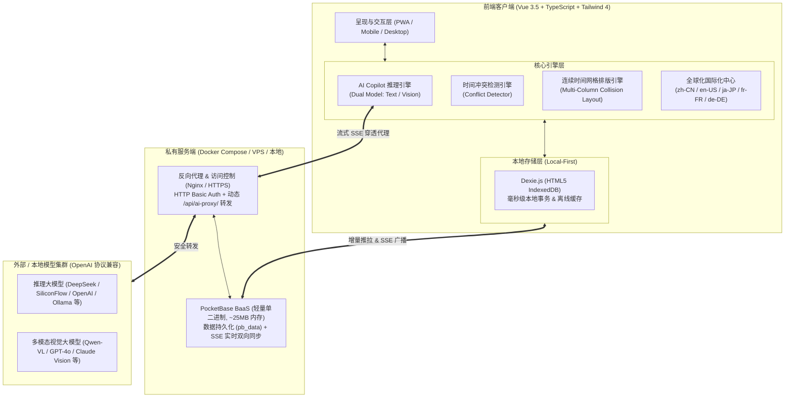

# Akasha

<p align="center">
  
</p>

<p align="center">
  <strong>现代化本地优先个人生产力与工作流架构系统</strong><br>
  <em>A Modern, Local-First Personal Productivity & Architecture Flow OS</em>
</p>

<p align="center">
  <a href="README.md"><strong>简体中文</strong></a> •
  <a href="README_EN.md">English</a>
</p>

<p align="center">
  <a href="https://github.com/yyzmiao/Akasha/releases"></a>
  <a href="https://vuejs.org/"></a>
  <a href="https://www.typescriptlang.org/"></a>
  <a href="https://vitejs.dev/"></a>
  <a href="https://tailwindcss.com/"></a>
  <a href="https://dexie.com/"></a>
  <a href="https://pocketbase.io/"></a>
  <a href="https://vitest.dev/"></a>
  <a href="LICENSE"></a>
</p>

---

## 📌 架构愿景与设计哲学

**Akasha** 并非传统的碎片化清单或娱乐向待办工具，而是一套面向**高阶专业人士、系统化创作者与严谨思考者**构建的**商业级个人效能与全流程工作架构系统 (Personal Architecture Flow OS)**。

在现代工作与生活中，知识工作者面临三大核心矛盾：
1. **工具链严重割裂**：任务分解在待办软件、日程排期在日历系统、行为管理在习惯追踪、思考复盘在笔记文档，信息流转损耗巨大；
2. **云端隐私与厂商锁定**：商业 SaaS 平台掌控数据主权，网络波动导致操作延迟，订阅制成本高昂且随时面临数据泄露隐患；
3. **AI 协同悬浮脱节**：市面多数 AI 仅提供悬浮对话框，无法穿透真实业务上下文进行时空冲突检测与智能结构化落地。

**Akasha 确立了四大核心设计原则：**

* 🛡️ **绝对数据主权与本地优先 (Local-First & Privacy First)**：所有业务数据持久化于本地浏览器 IndexedDB 中，离线状态毫秒级无感操作，零第三方强制依赖；
* 🧩 **顶层至终端的闭环治理 (Closed-Loop Governance)**：形成「顶层领域（Areas）➔ 阶段项目（Projects）➔ 任务决策树（Todos）➔ 连续时间网格（Schedules）➔ 惯性习惯（Habits）➔ 复盘反思（Journals）」的完整系统闭环；
* 🤖 **原生多模态 AI 智能副驾驶 (Multimodal Copilot Engine)**：将大语言模型推理与视觉解析引擎深度植入业务核心，支持双模型解耦配置、截图秒变排期、智能时间冲突探测；
* ⚡ **生产级分布式实时同步 (Enterprise-Grade Real-Time Sync)**：结合轻量级 PocketBase BaaS 引擎，依托 SSE (Server-Sent Events) 与增量推拉机制，实现毫秒级多端双向广播与可靠容灾。

---

## 🏗️ 整体系统架构与数据流



---

## ⚡ 核心系统特性矩阵

### 1. 顶层战略中枢：领域与项目治理 (Areas & Projects)
* **全局战略领域 (Areas of Responsibility)**：按人生与业务维度开辟长期关注领域（例如：研发架构、商业增长、学业深造、生活财务、身心健康）。
* **项目全生命周期 (Project Lifecycle)**：支持项目归属、状态推进、专属视觉色彩识别以及富文本目标设定。
* **三位一体任务聚合**：在单一项目视窗中无缝穿透管理该项目归属的**执行待办**、**固定日程**与**习惯打卡**。
* **动态进度度量**：基于子任务完成状态与权重算法，实时计算项目完成度百分比与可视化进度线。

### 2. 高精度连续时间网格与日程系统 (Continuous Time Grid & Scheduling)
* **24 小时连续时间网格**：彻底告别简陋的时间块列表，日历视图采用高精度绝对时间物理坐标轴，精准呈现全天时间流。
* **多任务重叠自适应分栏算法 (`timelineLayout`)**：独创的时间冲突横向自适应列宽分配算法，当多个日程/跨度待办在相同时间段重叠时，系统自动计算最大重叠阶数，等比智能分配横向列宽，杜绝视觉挤压与重叠遮挡。
* **高精度“当前时刻”游标 (Now Cursor)**：红线游标沿绝对时间轴以精确分钟比例自适应推进，当前进行中的日程高亮凸显。
* **跨周期排期规则**：支持单次绝对时间日程、每周固定日排期（如团队例会）、每月固定日排期（如财务结算）。

### 3. 多模态 AI 智能副驾驶 (Multimodal AI Copilot Engine)
* **双模型独立解耦架构 (Dual-Model Decoupling)**：
  * **主文字规划模型 (Chat Engine)**：负责意图拆解、任务优先级评估、自然语言排期规划；
  * **独立视觉模型 (Vision Multimodal API)**：支持与主模型完全独立的 Provider / BaseUrl / APIKey / Model 配置，可搭配最具性价比的视觉识别端点。
* **智能冲突探测推演 (`conflictDetector`)**：在计划制定或导入时，毫秒级扫描已有时间轴，秒级检出潜在的时间段重叠冲突并输出预警。
* **图片多模态智能排期提取**：直接截屏或粘贴工作排期表、高校课表、会议议程图，AI 视觉引擎全自动解析并提取结构化数据，一键批量灌入日历。
* **安全流式反向代理 (`/api/ai-proxy/`)**：内置 Nginx 动态流式中间件，解决前端调用三方大模型 API 的跨域限制，保障 SSE (Server-Sent Events) 打字机级逐字渲染。

### 4. 递归任务决策工程：无限多级待办树 (Recursive Multi-Depth Todo Tree)
* **无限深度结构化拆解**：支持自战略目标 ➔ 阶段任务 ➔ 攻坚项 ➔ 最小行动单元（Next Physical Action）的无限层级嵌套。
* **状态双向联动与折叠交互**：父子节点双向级联，支持单树枝深度折叠，保障高阶项目下的视觉整洁。
* **P1 ~ P10 十级权重度量**：精细化滑动权重评分，结合逾期自动警报（今日截止、剩余 N 天、逾期 N 天），精准锁定关键攻坚点。

### 5. 行为惯性工程：多频度习惯矩阵 (Habits & Consistency Engine)
* **时段分类驱动**：精细划分晨间（Morning）、午后（Afternoon）、晚间（Evening）与全天（Anytime）打卡象限。
* **复合周期规划**：全面支持按日、按周、双周以及按月维度的规律行为约束。
* **连续执飞追踪 (Current Streak & Best Record)**：精准度量坚持天数与历史极值，提供确定性正向行为反馈。

### 6. 深度反思沉淀：随笔与每日复盘 (Reflective Journaling & Audit)
* **日期锚定双向流**：与日历完全互通，支持任意时间戳的结构化心得随笔、情绪状态与复盘输出。
* **月度时光检索目录**：侧边卡片按月份无损聚合，支持快速按月检索历史沉淀。

### 7. 全球化与本地化体系 (Enterprise i18n Localization)
* **原生 5 语言全链路覆盖**：系统内置并深度适配简体中文（zh-CN）、英语（en-US）、日语（ja-JP）、法语（fr-FR）、德语（de-DE）。
* **动态自适应时区与格式化**：不同语言环境下，时间格式、星期缩写与日历月份自适应按照国际通用惯例智能排版。

### 8. 宏观环境与状态感知 (Atmospheric & Status Perception)
* **实时气象感知微件**：支持精确至地级市/区县的多级行政区划定位与温度、天气状况展示。
* **权威预报系统外链**：一键穿透直达专业天气平台，辅助出差与户外日程规划。

### 9. 生产级多端实时同步与离线容灾 (PocketBase Realtime Synchronization)
* **轻量级微服务架构**：基于 PocketBase 单二进制 BaaS（内存占用仅 ~25MB），持久化保存于宿主机本地。
* **双向增量同步与墓碑防复活机制**：网络中断时毫秒级写入本地 IndexedDB，网络恢复后智能比对 `updatedAt` 时间戳进行增量同步；删除项通过墓碑机制标记，杜绝重连复活。
* **SSE 实时长连接广播**：移动端打卡，桌面端无需刷新，毫秒级响应并即时同步状态。

---

## 🛠️ 技术规格与工程实现

| 分层维度 | 技术选型 | 说明 / 优势 |
| :--- | :--- | :--- |
| **核心前端框架** | **Vue 3.5+** | 深度使用 Composition API、`<script setup>`、响应式系统与计算属性 |
| **开发语言** | **TypeScript 5+** | 完备的类型安全，覆盖领域、任务树、AI 配置与协议定义 |
| **构建与打包工具** | **Vite 8.x** | 秒级 HMR 模块热更，极致生产打包优化 |
| **原子化样式引擎** | **Tailwind CSS 4.x** | 现代色彩体系、深浅模式平滑无缝过渡、自适应流式网格 |
| **本地优先数据库** | **Dexie.js (IndexedDB)** | 高性能异步存储，提供强大的索引检索与离线事务能力 |
| **自动化测试框架** | **Vitest 5.x** | **26 项单元测试用例 100% 自动化覆盖**（冲突检测、时间线网格、AI 服务等） |
| **图标与视觉系统** | **Lucide Vue Next** | 统一、精致的高级矢量图标库 |
| **排版默认字体** | **LXGW WenKai Screen** | 文雅温润的屏幕阅读字体，兼顾美学与专业度 |
| **同步与 BaaS 核心** | **PocketBase (Golang)** | 单二进制单文件数据库，嵌入式 SQLite，极致轻量稳定 |
| **容器与部署编排** | **Docker & Docker Compose** | 生产多阶段静态镜像构建，内置 Nginx 反代与健康检查 |

---

## 🚀 生产部署与运行指南 (Deployment Guide)

本项目支持部署在**个人工作电脑**或**公网私有云服务器（VPS）**中：

### 方式一：个人电脑极速启动 (Local Running)

#### 1. Node.js 本地开发模式
```bash
# 克隆代码仓库
git clone https://github.com/yyzmiao/Akasha.git
cd Akasha

# 安装依赖
npm install

# 运行自动化测试确保环境正常
npm test

# 启动本地开发服务 (默认 http://localhost:5173/)
npm run dev
```

#### 2. 本地 Docker 容器化运行
```bash
docker compose up -d --build
# 访问 http://localhost:8080
```

---

### 方式二：私有云服务器生产部署 (Production Server / VPS)

#### 第一步：启动容器集群
在服务器拉取代码并启动标准 Docker 编排服务：
```bash
git clone https://github.com/yyzmiao/Akasha.git
cd Akasha

# 编译并拉起 Akasha 前端与 PocketBase 容器
docker compose up -d --build
```
> **数据持久化说明**：PocketBase 的所有用户与同步数据持久化存储于宿主机的 `./pb_data` 目录中，升级或重启容器不会丢失任何数据。

#### 第二步：配置域名反代与访问安全鉴权 (推荐)
Akasha 提供标准化生产反代模版 [`deploy/nginx-proxy.conf`](deploy/nginx-proxy.conf) 与密码配置示例 [`deploy/.htpasswd.example`](deploy/.htpasswd.example)。

结合 **Nginx 反向代理** 与 **HTTP Basic Auth**，无需暴露未保护端口即可原生建立企业级安全访问屏障：

```nginx
# 参考配置片段 (/etc/nginx/conf.d/akasha.conf)
server {
    listen 80;
    listen 443 ssl http2;
    server_name your-domain.com;

    ssl_certificate     /etc/nginx/certs/fullchain.pem;
    ssl_certificate_key /etc/nginx/certs/privkey.pem;

    # 启用安全账号密码认证
    auth_basic "Akasha Access Authentication";
    auth_basic_user_file /etc/nginx/conf.d/.htpasswd;

    # 关键放行：PWA Manifest 与 Service Worker（确保手机桌面免密检测与离线安装）
    location = /manifest.json {
        auth_basic off;
        proxy_pass http://127.0.0.1:8080;
    }
    location = /sw.js {
        auth_basic off;
        proxy_pass http://127.0.0.1:8080;
    }
    location ~* ^/(icon-.*\.png|apple-touch-icon.*\.png|favicon\..*)$ {
        auth_basic off;
        proxy_pass http://127.0.0.1:8080;
    }

    # 主站反向代理 (受鉴权保护)
    location / {
        proxy_pass http://127.0.0.1:8080;
        proxy_http_version 1.1;
        proxy_set_header Upgrade $http_upgrade;
        proxy_set_header Connection "upgrade";
        proxy_set_header Host $host;
        proxy_set_header X-Real-IP $remote_addr;
        proxy_set_header X-Forwarded-For $proxy_add_x_forwarded_for;
        proxy_set_header X-Forwarded-Proto $scheme;
    }
}
```

---

## 📂 项目工程架构一览

```text
Akasha/
├── .github/
│   └── workflows/
│       └── ci.yml               # GitHub Actions 自动化 CI 验证工作流 (Test & Build)
├── deploy/                      # 生产级部署与反向代理模板
│   ├── .htpasswd.example        # Basic Auth 凭据配置样例
│   └── nginx-proxy.conf         # 生产 Nginx SSL/反代模板
├── public/                      # PWA 清单、静态图标与离线工作线程
│   ├── icon-check-192.png       # 192x192 标准 PWA 图标
│   ├── icon-check-512.png       # 512x512 高清视网膜图标
│   ├── manifest.json            # Web App 独立应用元数据定义
│   └── sw.js                    # Service Worker 离线网络拦截与缓存
├── src/
│   ├── components/              # 核心功能业务组件
│   │   ├── copilot/
│   │   │   └── CopilotModal.vue # AI 智能副驾驶交互弹窗 (规划、推演、识图导入)
│   │   ├── CalendarView.vue     # 连续时间网格与自适应动态月历看板
│   │   ├── GlobalSearch.vue     # 全景穿透搜索引擎
│   │   ├── HabitsView.vue       # 行为惯性与习惯打卡管理
│   │   ├── JournalView.vue      # 结构化随笔与复盘归档
│   │   ├── Navbar.vue           # 系统顶栏、天气状态与功能导航
│   │   ├── ProjectView.vue      # 领域与项目卡片流及三位一体详情
│   │   ├── ScheduleView.vue     # 固定日程规约列表
│   │   ├── SettingsDrawer.vue   # 抽屉式系统配置 (双模型AI、国际化、多端同步)
│   │   ├── SyncStatusBadge.vue  # 云端长连接实时状态指示徽标
│   │   ├── TodoTreeItem.vue     # 无限多级待办递归渲染项
│   │   ├── TodoView.vue         # 待办清单多维矩阵视图
│   │   └── WeatherWidget.vue    # 气象感知微件
│   ├── db/
│   │   └── index.ts             # Dexie.js 本地 IndexedDB 模式与事务封装
│   ├── services/
│   │   ├── aiService.ts         # 多端点 AI 调度器 (Chat / Vision / 动态代理)
│   │   └── conflictDetector.ts  # 时间时空冲突探测引擎
│   ├── sync/
│   │   ├── pocketbase.ts        # PocketBase SDK 实例与鉴权上下文
│   │   └── syncEngine.ts        # 增量推拉同步引擎与 SSE 广播监听器
│   ├── types/
│   │   ├── copilot.ts           # AI 引擎与双模型端点类型定义
│   │   └── index.ts             # 领域、项目、待办、日程、习惯核心类型
│   ├── utils/
│   │   ├── date.ts              # 日期计算与周期算法
│   │   ├── habit.ts             # 习惯连胜与打卡统计
│   │   ├── i18n.ts              # 5国语言本地化多语言字典与国际化引擎
│   │   ├── priority.ts          # 任务优先级权重算法
│   │   ├── timelineLayout.ts    # 连续时间网格多列重叠自适应排版算法
│   │   ├── tree.ts              # 任务递归树遍历、折叠与聚合算法
│   │   ├── version.ts           # 版本元数据与内测环境探针
│   │   └── weather.ts           # 行政区划解析与气象映射
│   ├── App.vue                  # 根视图组件与全局状态中枢
│   ├── main.ts                  # 应用入口点
│   └── style.css                # Tailwind 基础层与自定义微动效
├── tests/                       # Vitest 自动化单元测试套件 (100% 覆盖关键核心)
│   ├── aiService.test.ts        # AI 调度与双模型端点测试
│   ├── conflictDetector.test.ts # 时间段冲突检出逻辑测试
│   ├── i18n.test.ts             # 多语言格式化测试
│   └── timelineLayout.test.ts   # 连续时间网格多列冲突避让算法测试
├── Dockerfile                   # 生产环境 Node.js 编译 + Nginx 轻量镜像
├── docker-compose.yml           # 一键启动 Akasha + PocketBase 编排定义
├── nginx.conf                   # 容器内置 Nginx 路由与 AI 动态反代规则
├── package.json                 # 项目依赖与元数据配置
├── tsconfig.json                # TypeScript 编译器配置
└── vite.config.ts               # Vite 构建工程配置
```

---

## 🔒 数据迁移与格式标准 (Data Sovereignty)

* **零锁定标准 JSON 导出**：支持随时一键导出包含 `areas`、`projects`、`schedules`、`todos`、`habits`、`habitLogs`、`journals` 及 `aiConfig` 的全量 JSON 备份。
* **严格 Schema 校验**：数据导入机制支持事务级原子覆盖，提供合规性与数组完整性预检，防止异常损坏现有数据。

---

## 📄 开源许可证 (License)

本项目采用 [MIT License](LICENSE) 协议开源。任何人均可自由部署、使用、修改或二次开发。
