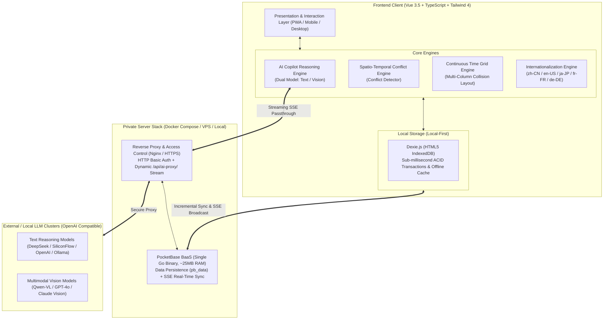

# Akasha

<p align="center">
  
</p>

<p align="center">
  <strong>A Modern, Local-First Personal Productivity & Architecture Flow OS</strong><br>
  <em>Systematic, high-reliability personal execution framework featuring Multimodal AI Copilot, Continuous Time Grid, Multi-Depth Decision Trees, and Private Real-Time Sync.</em>
</p>

<p align="center">
  <a href="README.md">简体中文</a> •
  <a href="README_EN.md"><strong>English</strong></a>
</p>

<p align="center">
  <a href="https://github.com/yyzmiao/Akasha/releases"></a>
  <a href="https://vuejs.org/"></a>
  <a href="https://www.typescriptlang.org/"></a>
  <a href="https://vitejs.dev/"></a>
  <a href="https://tailwindcss.com/"></a>
  <a href="https://dexie.com/"></a>
  <a href="https://pocketbase.io/"></a>
  <a href="https://vitest.dev/"></a>
  <a href="LICENSE"></a>
</p>

---

## 📌 Architecture Vision & Core Philosophy

**Akasha** is not an ephemeral checklist or casual habit gamifier. It is a commercial-grade **Personal Architecture Flow OS** designed specifically for **knowledge workers, engineers, researchers, and systematic thinkers**.

Modern professionals encounter three fundamental productivity bottlenecks:
1. **Fragmented Toolchains**: Task breakdowns live in todo apps, time blocking lives in calendars, routines live in habit trackers, and retrospective thoughts live in notes. Context switching wastes substantial cognitive energy.
2. **Cloud Vulnerability & Vendor Lock-in**: Commercial SaaS vendors own your private data, introduce network latency, charge recurring subscription fees, and risk data breaches.
3. **Superficial AI Wrappers**: Most consumer AI tools offer generic chat bubbles detached from your real-world calendar constraints, unable to detect scheduling conflicts or produce structured actions.

**Akasha addresses these challenges through four foundational principles:**

* 🛡️ **Absolute Data Sovereignty (Local-First)**: All operational data resides permanently in your local browser's IndexedDB. Zero mandatory third-party dependency, instant sub-millisecond response, and 100% offline capability.
* 🧩 **Closed-Loop Execution Hierarchy**: A cohesive pipeline mapping high-level **Areas of Responsibility** ➔ strategic **Projects** ➔ recursive **Todo Trees** ➔ physical **Continuous Time Grids** ➔ behavioral **Habits** ➔ retrospective **Journals**.
* 🤖 **Deep Multimodal Copilot Integration**: Native LLM reasoning and multimodal vision capabilities embedded directly into the workflow—offering decoupled dual-model routing, image-to-schedule extraction, and spatial-temporal collision detection.
* ⚡ **Enterprise-Grade Distributed Sync**: Ultra-lightweight PocketBase BaaS (~25MB RAM) paired with SSE (Server-Sent Events) and incremental tombstone reconciliation for instant multi-device broadcasting and disaster recovery.

---

## 🏗️ System Architecture & Data Topology



---

## ⚡ Core Feature Matrix

### 1. Strategic Governance: Areas & Projects
* **Areas of Responsibility**: Establish permanent life and career domains (e.g., Systems Engineering, Business Growth, Academic Research, Financial Health).
* **Project Lifecycle Management**: Color-coded project cards with rich targets, progress tracking, and complete lifecycle states.
* **Unified Tripartite Aggregation**: Manage associated **Todos**, **Schedules**, and **Habits** seamlessly within each dedicated project view.
* **Weighted Progress Measurement**: Dynamic percentage indicators calculated in real time from underlying action items.

### 2. High-Precision Continuous Time Grid & Scheduling
* **24-Hour Continuous Time Grid**: Replaces crude block lists with an absolute physical coordinate timeline accurately plotting every minute of the day.
* **Adaptive Multi-Column Collision Layout (`timelineLayout`)**: Proprietary layout algorithm that calculates maximum overlap tiers when multiple events coincide, proportionally distributing horizontal lane widths to prevent visual clipping or overlapping.
* **Dynamic "Now" Cursor**: Minute-precise real-time red line tracking current progress, automatically highlighting active events.
* **Flexible Recurrence Rules**: Single events, fixed weekly routines (e.g., engineering syncs), and fixed monthly schedules.

### 3. Multimodal AI Copilot Engine
* **Decoupled Dual-Model Configuration**:
  * **Chat Engine**: Natural language task breakdown, prioritization, and time-block drafting.
  * **Dedicated Vision API**: Configure an independent Provider, Base URL, API Key, and Model specifically tuned for multimodal visual document extraction.
* **Predictive Conflict Detection (`conflictDetector`)**: Scans existing commitments in milliseconds to identify overlap hazards before committing plans.
* **Image-to-Schedule OCR & Parsing**: Paste or upload timetables, conference agendas, or meeting roadmaps; AI automatically extracts structured calendar blocks for one-click import.
* **Secure Dynamic Streaming Proxy (`/api/ai-proxy/`)**: Embedded Nginx streaming middleware eliminates browser CORS restrictions and guarantees smooth SSE typing streams.

### 4. Recursive Decision Engineering: Multi-Depth Todo Trees
* **Infinite Nested Decomposition**: Deconstruct initiatives from macro objectives down to phase milestones, discrete work packages, and Next Physical Actions.
* **Bidirectional Cascade & Branch Folding**: Collapse entire branches for cognitive clarity while maintaining aggregate completion status.
* **P1 ~ P10 Priority Granularity**: Continuous priority slider paired with intelligent deadline alerts (Due Today, N Days Left, Overdue).

### 5. Habit Consistency Engineering: Multiphase Habits
* **Time-of-Day Quadrants**: Classify routines across Morning, Afternoon, Evening, or Anytime blocks.
* **Variable Frequency Cadences**: Daily, weekly target frequency, bi-weekly, and monthly recurring commitments.
* **Streak & Resilience Metrics**: Track continuous active streaks alongside historical all-time records for positive behavioral reinforcement.

### 6. Reflective Journaling & Audit
* **Date-Anchored Double Stream**: Structured daily debriefs, mood tracking, and retrospective logs tied directly to calendar dates.
* **Monthly Archive Vault**: Chronological sidebar cards grouped by month for rapid historical search and review.

### 7. Enterprise Internationalization (i18n)
* **Native 5-Language Support**: Complete translations for English (en-US), Simplified Chinese (zh-CN), Japanese (ja-JP), French (fr-FR), and German (de-DE).
* **Localized Temporal Formatting**: Adaptive date conventions, weekday abbreviations, and month nomenclatures adhering to international typographic standards.

### 8. Environmental Perception & Weather
* **Integrated Meteorological Widget**: Multi-tiered administrative location mapping displaying real-time weather and temperature.
* **Authoritative External Links**: One-click passthrough to meteorological services for travel and field planning.

### 9. Production-Grade Multi-Device Sync (PocketBase)
* **Microservices Footprint**: Backed by PocketBase (~25MB RAM footprint), embedded SQLite, and file-based zero-configuration storage.
* **Tombstone Sync**: True offline operation via IndexedDB; changes reconcile upon reconnection via timestamp deltas, with deletion tombstones preventing phantom restorations.
* **Instant SSE Broadcast**: Actions taken on mobile reflect instantaneously across desktop sessions without manual page refreshes.

---

## 🛠️ Technology Stack & Engineering Standards

| Dimension | Technology | Architecture Rationale |
| :--- | :--- | :--- |
| **Frontend Framework** | **Vue 3.5+** | Composition API, `<script setup>`, granular reactivity |
| **Language** | **TypeScript 5+** | Strict static typing across domains, task trees, and sync schemas |
| **Build System** | **Vite 8.x** | Instant HMR, Rolldown-accelerated minification, production bundling |
| **Styling Engine** | **Tailwind CSS 4.x** | Zero-runtime modern utility styling, seamless light/dark palettes |
| **Local Storage** | **Dexie.js (IndexedDB)** | High-throughput indexed transactions, client-side resilience |
| **Test Suite** | **Vitest 5.x** | **26 Unit Tests with 100% Pass Rate** covering conflict detection, timeline math, and AI dispatch |
| **Iconography** | **Lucide Vue Next** | Cohesive vector icon system |
| **Typography** | **LXGW WenKai Screen** | High-readability screen font balancing aesthetics and clarity |
| **Sync Engine** | **PocketBase (Golang)** | Embedded single-binary BaaS, ultra-lightweight SSE streaming |
| **Containerization** | **Docker & Docker Compose** | Multi-stage build, hardened Nginx proxy with TLS and Basic Auth |

---

## 🚀 Production Deployment Guide

Akasha can be deployed locally or hosted on a private Virtual Private Server (VPS):

### Method 1: Local Machine Execution

```bash
# Clone the repository
git clone https://github.com/yyzmiao/Akasha.git
cd Akasha

# Install dependencies
npm install

# Run automated tests
npm test

# Launch local dev server (default: http://localhost:5173/)
npm run dev
```

Alternatively, run locally with Docker:
```bash
docker compose up -d --build
# Access via http://localhost:8080
```

---

### Method 2: Production Server / VPS Deployment

#### Step 1: Launch Containers
```bash
git clone https://github.com/yyzmiao/Akasha.git
cd Akasha

# Build and start Akasha frontend and PocketBase services
docker compose up -d --build
```
> **Data Persistence**: PocketBase data is mapped to `./pb_data` on the host machine. Upgrades and restarts preserve all data automatically.

#### Step 2: Configure Reverse Proxy with Access Protection
Refer to the provided templates [`deploy/nginx-proxy.conf`](deploy/nginx-proxy.conf) and [`deploy/.htpasswd.example`](deploy/.htpasswd.example).

Using **Nginx Reverse Proxy** with **HTTP Basic Auth** provides enterprise-grade perimeter security:

```nginx
# Example Server Block (/etc/nginx/conf.d/akasha.conf)
server {
    listen 80;
    listen 443 ssl http2;
    server_name your-domain.com;

    ssl_certificate     /etc/nginx/certs/fullchain.pem;
    ssl_certificate_key /etc/nginx/certs/privkey.pem;

    # Secure HTTP Basic Auth
    auth_basic "Akasha Access Authentication";
    auth_basic_user_file /etc/nginx/conf.d/.htpasswd;

    # Whitelist PWA Manifest and Service Worker for installation
    location = /manifest.json {
        auth_basic off;
        proxy_pass http://127.0.0.1:8080;
    }
    location = /sw.js {
        auth_basic off;
        proxy_pass http://127.0.0.1:8080;
    }
    location ~* ^/(icon-.*\.png|apple-touch-icon.*\.png|favicon\..*)$ {
        auth_basic off;
        proxy_pass http://127.0.0.1:8080;
    }

    # Main Application Proxy
    location / {
        proxy_pass http://127.0.0.1:8080;
        proxy_http_version 1.1;
        proxy_set_header Upgrade $http_upgrade;
        proxy_set_header Connection "upgrade";
        proxy_set_header Host $host;
        proxy_set_header X-Real-IP $remote_addr;
        proxy_set_header X-Forwarded-For $proxy_add_x_forwarded_for;
        proxy_set_header X-Forwarded-Proto $scheme;
    }
}
```

---

## 📂 Repository File Structure

```text
Akasha/
├── .github/
│   └── workflows/
│       └── ci.yml               # GitHub Actions CI pipeline (Node 22 LTS, Test & Build)
├── deploy/                      # Production deployment templates
│   ├── .htpasswd.example        # Basic Auth credential template
│   └── nginx-proxy.conf         # Production Nginx SSL configuration
├── public/                      # Static assets, icons & PWA manifest
├── src/
│   ├── components/              # Vue UI components
│   │   ├── copilot/             # Copilot modal, planning & vision ingestion
│   │   ├── CalendarView.vue     # Continuous grid & responsive monthly calendar
│   │   ├── GlobalSearch.vue     # Omnipresent global spotlight search
│   │   ├── HabitsView.vue       # Habit matrix & streak tracking
│   │   ├── JournalView.vue      # Retrospective journals & archive
│   │   ├── Navbar.vue           # Header navigation & weather status
│   │   ├── ProjectView.vue      # Domain & project workspace
│   │   ├── ScheduleView.vue     # Recurring schedule management
│   │   ├── SettingsDrawer.vue   # Configuration drawer (Dual AI, Sync, i18n)
│   │   ├── TodoTreeItem.vue     # Recursive task tree item
│   │   └── TodoView.vue         # Multidimensional todo matrix
│   ├── services/
│   │   ├── aiService.ts         # Multi-endpoint AI dispatcher & streaming
│   │   └── conflictDetector.ts  # Timeline conflict detection engine
│   ├── sync/
│   │   ├── pocketbase.ts        # PocketBase client & auth store
│   │   └── syncEngine.ts        # Incremental sync engine & SSE listener
│   ├── utils/
│   │   ├── timelineLayout.ts    # Multi-column overlap allocation algorithm
│   │   ├── i18n.ts              # 5-Language internationalization dictionary
│   │   ├── date.ts              # High-precision time and calendar math
│   │   └── tree.ts              # Recursive tree traversal algorithms
│   ├── App.vue                  # Root orchestrator
│   └── main.ts                  # Application entry point
├── tests/                       # Vitest unit test suite (100% coverage on core)
├── Dockerfile                   # Multi-stage production container build
├── docker-compose.yml           # Compose specification for Akasha + PocketBase
├── nginx.conf                   # Embedded Nginx proxy & SSE AI proxy rules
└── package.json                 # Dependencies & project metadata
```

---

## 🔒 Data Portability & Backup Specification

* **Zero-Lockout JSON Export**: Export your entire dataset (`areas`, `projects`, `schedules`, `todos`, `habits`, `habitLogs`, `journals`, `aiConfig`) into standard structured JSON at any time.
* **Atomic Import Validation**: Incoming backups undergo strict schema sanity checks before executing an atomic database transaction.

---

## 📄 License

Distributed under the [MIT License](LICENSE). Open for self-hosting, auditing, and continuous improvement.
